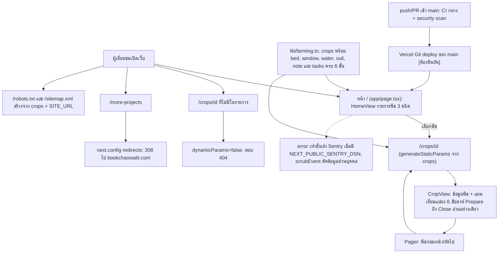

# 01 — Business process (As-Is / To-Be)

smart-farming-web (Field / Book) คือเว็บอ่านสมุดบันทึกพืชประจำฤดูกาลสำหรับผู้เยี่ยมชมหรือเกษตรกรรายย่อย แสดงพืช 3 ชนิด (กระเจี๊ยบ โหระพา ผักบุ้ง) พร้อมแผนเยี่ยมแปลง 6 สัปดาห์ ข้อมูลเป็นตัวอย่างที่เขียนไว้ในโค้ด หน้าเว็บสร้างแบบ static ไม่มี API ไม่มีบัญชีผู้ใช้ และไม่มีข้อมูลสดจากเซ็นเซอร์หรือสภาพอากาศ

Last reviewed: 2026-11-28 · commit `feef7cf`

## As-Is (จากโค้ดวันนี้)

Sources: `app/page.tsx`, `app/crops/[id]/page.tsx`, `components/fieldbook-views.tsx`, `lib/farming.ts`, `app/sitemap.ts`, `app/robots.ts`, `lib/site.ts`, `next.config.ts`, `lib/sentry.ts`, `instrumentation.ts`, `.github/workflows/ci.yml`

## To-Be (ไม่มี To-Be ที่เขียนไว้)

ไม่มี To-Be ที่เขียนไว้

## Gap

| ID | As-Is → To-Be | Status | Owner | Evidence |
|---|---|---|---|---|
| G1 | เดโมข้อมูลตัวอย่างที่ไม่มี roadmap → ต้องการเป้าหมายที่เขียนไว้ (คงเป็นเดโม หรือเพิ่มข้อมูลเกษตรจริง) | decide | owner | `PRODUCT.md` ระบุว่าเป็นตัวอย่างและไม่มีเป้าหมายถัดไป |

## Open questions

- `README.md` และ `PRODUCT.md` ยังบรรยายหน้าเดียวแบบ client ที่เลือกสัปดาห์และกด "Mark the next visit" ได้ แต่โค้ดตอนนี้เป็นหน้า server render บน Reader shell: แผน 6 สัปดาห์เป็นรายการอ่านอย่างเดียว ไม่มีการเลือกสัปดาห์: เอกสารล้าหลังโค้ด
- สถานะ deploy จริงของ Vercel ยืนยันจากโค้ดไม่ได้ [ต้องยืนยัน]
